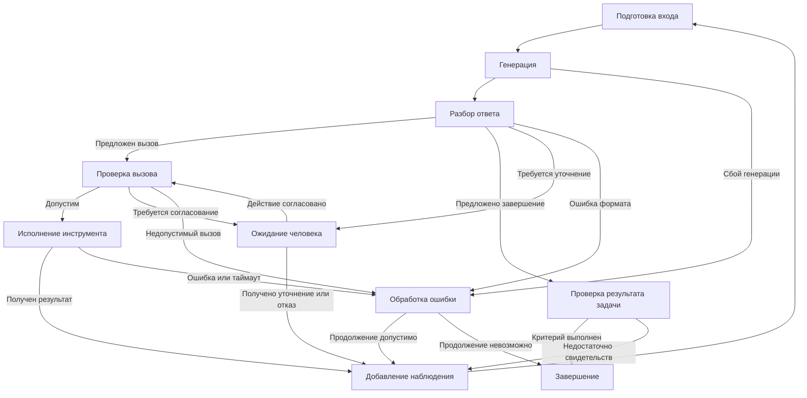

# Лекция 3. Анатомия агентной системы

Языковая модель порождает последовательность токенов. Для выполнения задачи во внешней среде требуется система, которая интерпретирует выход модели, проверяет допустимость предложенных действий, вызывает инструменты и возвращает результаты в контекст следующего обращения. Качество такой системы зависит как от способностей модели, так и от организации исполнения.

В [предыдущей лекции](../02-llm-training/notes.md) рассматривалось происхождение способностей LLM к выполнению инструкций, рассуждению и использованию инструментов. Предмет настоящей лекции — программные механизмы, связывающие эти способности с наблюдаемым результатом задачи. Первая глава посвящена представлению диалога и переходу от текста к вызову инструмента. В начале вводятся конечный автомат и граф состояний как язык описания исполнения. Вторая глава рассматривает агентный цикл, изменяемые данные и участие человека.

## Глава 1. От представления диалога к внешнему действию

### 1. Модель, харнесс, инструменты и среда

В качестве сквозного примера рассматривается задача: найти ошибку в файле, исправить ошибку и запустить проверку. Получение текста с предполагаемым исправлением ещё не означает изменения файла. Для выполнения задачи необходимы чтение текущего содержимого, применение изменения и получение результата проверки.

В такой системе выделяются четыре компонента.

| Компонент | Назначение | Пример в задаче исправления файла |
|---|---|---|
| Языковая модель | Формирование ответа или предложения о следующем действии на основе доступного контекста | Выбор файла для чтения, формирование исправления |
| Управляющая программа, или харнесс (*harness*) | Подготовка входа модели, интерпретация выхода, контроль исполнения и ведение состояния задачи | Проверка аргументов, вызов редактора, сохранение результата проверки |
| Инструменты | Предоставление определённых операций над внешними ресурсами | Чтение файла, применение изменения, запуск проверки |
| Среда | Совокупность ресурсов и процессов, с которыми взаимодействует система | Файловая система, содержимое проекта, процесс проверки |

Термин «харнесс» далее обозначает программный слой управления выполнением задачи. Границы этого слоя зависят от реализации: часть функций может находиться в приложении, часть — в сервисе, предоставляющем модель. Во всех случаях необходимо различать генерацию описания операции и выполнение операции. Даже при размещении модели и инструментов в одном сервисе изменение файла производится программным исполнителем.

Для постановки задачи существенны три составляющие: **требуемый результат**, **разрешённые действия** и **свидетельства выполнения**. В сквозном примере результатом служит исправленный файл; разрешённые действия ограничиваются заданным проектом; свидетельствами служат чтение изменённого содержимого и отчёт проверки. Если допустимый способ исправления неоднозначен, требуется уточнение постановки.

Уже на этом уровне различаются две ошибки. Модель может предложить неверное исправление при исправной работе инструментов. Харнесс может применить содержательно правильное исправление к другому файлу. Для анализа поведения требуется фиксировать не только ответ модели, но и последовательность фактически выполненных операций.

### 2. Конечный автомат и граф состояний

#### 2.1. Состояния, события и переходы

**Конечный автомат** — модель дискретного поведения с конечным множеством состояний. В рассматриваемом детерминированном случае текущее состояние и входное событие однозначно определяют следующее состояние. Обозначения: $Q$ — конечное множество состояний, $\Sigma$ — конечное множество входных событий, $q_0\in Q$ — начальное состояние, $\delta:Q\times\Sigma\to Q$ — функция переходов. После события $a_t$ выполняется переход

$$
q_{t+1}=\delta(q_t,a_t).
$$

Здесь $t$ обозначает номер перехода. В определении автомата — распознавателя языка дополнительно задаётся множество принимающих состояний $F\subseteq Q$. Для описания управления далее существенны состояния и переходы; принятие входной последовательности и завершение прикладной задачи не отождествляются. [Cornell CS 2800: Deterministic finite automata](https://www.cs.cornell.edu/courses/cs2800/2017fa/lectures/lec21-dfa.html).

В качестве простого примера рассматривается дверь с состояниями «Закрыта» и «Открыта». Начальное состояние — «Закрыта», входные события — команды «открыть» и «закрыть». Движение двери и отказы привода в этой учебной модели не учитываются.

| Текущее состояние | Входное событие | Следующее состояние |
|---|---|---|
| Закрыта | открыть | Открыта |
| Закрыта | закрыть | Закрыта |
| Открыта | открыть | Открыта |
| Открыта | закрыть | Закрыта |

Повторная команда может сохранять состояние. Конечность множества состояний не ограничивает число переходов: команды могут поступать многократно, а работа автомата не обязана завершаться после фиксированного числа шагов.

#### 2.2. Граф состояний и путь в графе

**Граф состояний** — представление переходов ориентированным графом. Вершины обозначают состояния, дуги — переходы, подписи дуг — входные события. Стрелка без исходной вершины указывает начальное состояние. Петля соответствует переходу в то же состояние. [Cornell CS 211: State machines](https://www.cs.cornell.edu/courses/cs211/2006sp/Lectures/L26-MoreGraphs/state_mach.html).


Граф включает все заданные переходы. **Путь в графе** описывает конкретную последовательность состояний и переходов по входным событиям, например:

```text
Закрыта — открыть → Открыта — закрыть → Закрыта
```

Таблица переходов и граф задают один и тот же автомат, а путь в графе показывает отдельный случай его работы. Цикл в графе допускает повторное посещение состояния и сам по себе не означает ошибку исполнения.

В графе харнесса вершины будут обозначать управляющие этапы, например генерацию ответа и проверку вызова. История сообщений, аргументы и согласования не сводятся к названию текущей вершины: далее они вводятся как данные расширенного конечного автомата. Это позволяет отдельно описывать допустимый порядок исполнения и конкретные сведения, с которыми работает система.

### 3. Представление диалога на входе модели

#### 3.1. Сообщения и роли

В прикладном интерфейсе диалог обычно представлен упорядоченным списком сообщений. Сообщение содержит роль и содержимое; дополнительные поля могут описывать вызовы инструментов и связи между ответами. В упрощённом текстовом случае используются роли `system`, `user`, `assistant` и, при соответствующей поддержке протокола, `tool`.

Роль задаёт назначение сообщения в протоколе. Системное сообщение содержит общие инструкции, пользовательское — постановку задачи или уточнение, сообщение ассистента — выход модели, сообщение инструмента — результат внешней операции. Названия и набор ролей зависят от интерфейса. Принадлежность сообщения роли инструмента указывает на источник данных, но сама по себе не гарантирует правильности содержимого.

Для объяснения сериализации используется короткий диалог:

```json
[
  {"role": "system", "content": "Ответ должен быть кратким."},
  {"role": "user", "content": "Вычислить 17 × 23."}
]
```

Этот JSON — представление данных для приложения. Текстовая авторегрессионная модель получает последовательность идентификаторов токенов. Преобразование сообщений во входную последовательность включает применение шаблона диалога (*chat template*) и токенизацию. Шаблон определяет оформление ролей, границы сообщений и начало ожидаемого ответа. Соответствие шаблона формату обучения существенно для интерпретации диалога моделью. [Документация Transformers о шаблонах диалога](https://huggingface.co/docs/transformers/main/en/chat_templating).

```text
Список сообщений
      ↓ применение шаблона
Оформленная текстовая последовательность
      ↓ токенизация
Последовательность идентификаторов токенов
      ↓ обработка моделью
Продолжение последовательности
```

#### 3.2. Конкретный пример: Zephyr-7B-β

В модели `HuggingFaceH4/zephyr-7b-beta` перед содержимым сообщения размещается обозначение роли, например `<|user|>`, а после содержимого — `</s>`. При подготовке нового ответа добавляется заголовок ассистента. Следующая сокращённая запись Jinja воспроизводит результат опубликованного шаблона для непустого списка текстовых сообщений с ролями `system`, `user` и `assistant`. Значение `eos_token` равно `</s>`. [Конфигурация токенизатора Zephyr-7B-β](https://huggingface.co/HuggingFaceH4/zephyr-7b-beta/blob/main/tokenizer_config.json).

```jinja

{{ '<|' + message['role'] + '|>\n' + message['content'] + eos_token + '\n' }}


{{ '<|assistant|>\n' }}

```

При `add_generation_prompt = true` результат для приведённых сообщений имеет вид:

```text
<|system|>
Ответ должен быть кратким.</s>
<|user|>
Вычислить 17 × 23.</s>
<|assistant|>
```

Jinja исполняется программой подготовки входа. Модель получает результат подстановки после токенизации; инструкции цикла и условного оператора шаблона не выполняются моделью. В данном примере шаблон проходит по сообщениям, добавляет обозначения ролей и завершает строку заголовком нового ответа. Механизм исполнения шаблонов описан в [руководстве Transformers по созданию chat templates](https://huggingface.co/docs/transformers/main/en/chat_templating_writing).

Последний заголовок определяет позицию продолжения: ожидается содержимое сообщения ассистента. Для других моделей способ обозначения начала ответа может отличаться. Дополнительное автоматическое добавление служебных токенов после применения шаблона способно продублировать уже вставленные разделители. Поэтому сериализация и токенизация должны быть согласованы. [Документация Transformers, параметры подготовки генерации](https://huggingface.co/docs/transformers/main/en/chat_templating#add_generation_prompt).

#### 3.3. Текстовые обозначения и специальные токены

Внешний вид строки не определяет способ токенизации. В опубликованной конфигурации Zephyr специальные токены включают `<s>`, `</s>` и `<unk>`, тогда как обозначения `<|system|>`, `<|user|>` и `<|assistant|>` не зарегистрированы как отдельные специальные токены. Следовательно, роль может обозначаться обычной текстовой последовательностью, разбиваемой токенизатором. Запись, похожая на тег, не обязательно соответствует одному идентификатору. [Конфигурация специальных токенов Zephyr-7B-β](https://huggingface.co/HuggingFaceH4/zephyr-7b-beta/blob/main/tokenizer_config.json).

В пределах диалога `</s>` может встречаться после нескольких сообщений. Наличие такого токена внутри входа не означает немедленного завершения всей задачи. Также необходимо различать прекращение одной генерации и завершение агентного цикла: после ответа с вызовом инструмента часто требуется новое обращение к модели.

Пример Zephyr иллюстрирует только текстовую сериализацию. Поддержка ролей инструментов и специальных полей требует соответствующего шаблона и подготовки модели. Перенос произвольного формата сообщений между моделями без проверки совместимости не обоснован.

### 4. Структурированный выход и контракт ответа

#### 4.1. Три уровня корректности

Программная обработка ответа требует явного контракта: какие поля допустимы, какие обязательны и какие значения могут содержать. Например, из фразы «Партия содержит 12 датчиков» требуется извлечь наименование изделия и количество. Ожидаемый ответ:

```json
{"item": "датчик", "count": 12}
```

Контракт задаётся схемой:

```json
{
  "type": "object",
  "properties": {
    "item": {"type": "string"},
    "count": {"type": "integer", "minimum": 0}
  },
  "required": ["item", "count"],
  "additionalProperties": false
}
```

Здесь `properties` описывает поля, `required` требует наличия обоих полей, а `additionalProperties: false` запрещает неописанные поля. Само присутствие имени в `properties` не делает поле обязательным. [Официальное руководство JSON Schema по объектам](https://json-schema.org/understanding-json-schema/reference/object).

Корректность ответа проверяется на нескольких уровнях.

| Уровень | Проверяемое свойство | Пример нарушения |
|---|---|---|
| Синтаксический | Ответ разбирается как JSON | `{"item": "датчик", "count": 12,}` — лишняя запятая |
| Структурный | Значение соответствует схеме | `{"item": "датчик", "count": "12"}` — строка вместо целого числа |
| Содержательный | Значения соответствуют исходным данным и задаче | `{"item": "датчик", "count": 120}` — неверное количество |

Последний пример удовлетворяет указанной схеме. Структура ограничивает форму ответа, но не устанавливает соответствие исходной фразе. Содержательная проверка требует обращения к данным или к независимому критерию правильности.

#### 4.2. Инструкция, ограничение генерации и валидация

Соблюдение контракта может обеспечиваться несколькими механизмами.

**Инструкция** описывает требуемую форму ответа в контексте модели. Например, задаётся требование вернуть только JSON с двумя указанными полями. Такая инструкция влияет на генерацию, но не исключает синтаксических нарушений.

**Ограниченное декодирование** (*constrained decoding*) ограничивает множество допустимых продолжений. Декодер может исключать токены, после добавления которых последовательность уже не сможет соответствовать заданной грамматике. Поддерживаемые требования схемы преобразуются в ограничения на генерацию. Пример реализации этого подхода представлен в работе о XGrammar. Грамматическое ограничение регулирует форму последовательности; правильность извлечённого количества требует отдельного критерия. [Dong et al., XGrammar](https://arxiv.org/abs/2411.15100).

**Валидация** проверяет уже полученное значение. Сначала выполняется синтаксический разбор, затем проверка схемы, затем прикладные проверки. Валидация позволяет обнаружить нарушение, но не исправляет ответ автоматически. Решение о повторной генерации, запросе уточнения или прекращении работы принимает управляющая программа.

Эти механизмы дополняют друг друга. Инструкция объясняет содержание задачи, ограничение декодирования сокращает число формально недопустимых продолжений, валидация определяет возможность дальнейшей обработки. Даже при ограниченном декодировании необходимо учитывать незавершённую генерацию, например остановку по лимиту токенов. Корректный префикс JSON ещё не является завершённым документом.

### 5. Вызов инструмента как протокол

#### 5.1. Описание инструмента и предложение вызова

Структурированный ответ может описывать действие. Механизм *tool calling*, также называемый *function calling*, связывает такое описание с программным исполнителем. Для этого системе необходимы описание доступной операции, формат запроса, правила проверки и способ возврата результата.

Описание инструмента содержит имя, назначение и схему аргументов. Реализация операции хранится у исполнителя. Передача описания функции в контекст обычно не означает передачу исходного кода функции. Такое разделение описания и выполнения используется, в частности, в интерфейсах инструментов Transformers. [Документация Transformers об использовании инструментов](https://huggingface.co/docs/transformers/main/en/chat_extras).

Ниже приведён учебный контракт инструмента умножения. Это условное представление для рассматриваемого харнесса, а не полный запрос к конкретному API.

```json
{
  "name": "multiply",
  "description": "Вычисляет произведение двух чисел.",
  "parameters": {
    "type": "object",
    "properties": {
      "a": {"type": "number"},
      "b": {"type": "number"}
    },
    "required": ["a", "b"],
    "additionalProperties": false
  }
}
```

Модель предлагает вызов. После разбора выхода харнесс представляет вызов в следующем нормализованном виде:

```json
{
  "kind": "tool_call",
  "call_id": "call_01",
  "name": "multiply",
  "arguments": {"a": 17, "b": 23}
}
```

Поле `name` определяет операцию, `arguments` — входные значения, `call_id` — связь с последующим результатом. Идентификатор может назначаться программным слоем. Наличие идентификатора вызова само по себе не предотвращает повторного выполнения операции: для такой гарантии требуется отдельный контракт исполнителя.

#### 5.2. Разбор, проверка и исполнение

Последовательность обработки вызова состоит из нескольких этапов.

1. **Разбор выхода.** Из ответа выделяются тип сообщения, имя инструмента и аргументы. Если ответ поступает частями, исполнение ожидает завершения и проверки вызова.
2. **Поиск инструмента.** Имя сопоставляется с записью в реестре разрешённых операций. Неизвестное имя не превращается в произвольную команду.
3. **Проверка аргументов.** Проверяются структура, типы и ограничения контракта. Для примера умножения необходимы два числовых значения.
4. **Проверка допустимости.** Учитываются полномочия, состояние задачи и необходимость согласования. Корректная строка пути ещё не означает разрешения изменять соответствующий файл.
5. **Исполнение.** Вызывается программная реализация операции.
6. **Регистрация результата.** Полученное значение или сведения об ошибке связываются с исходным вызовом и добавляются в историю.

Для успешного умножения нормализованный результат имеет вид:

```json
{
  "kind": "tool_result",
  "call_id": "call_01",
  "status": "success",
  "result": 391
}
```

После включения результата в контекст модель может сформировать ответ «Произведение равно 391». На этом пути в графе вычисление выполнено инструментом; модель выбрала операцию и использовала полученное наблюдение.

#### 5.3. API и фактический формат модели

Поля прикладного API не следует отождествлять с буквальным текстом входа и выхода модели. Сервер может преобразовывать сообщения, описания инструментов и результаты в специальный формат, а затем разбирать сгенерированную последовательность обратно в поля API. В открытых моделях эту функцию могут выполнять шаблон диалога и отдельный парсер. [Документация Transformers, пример tool calling](https://huggingface.co/docs/transformers/main/en/chat_extras#tool-calling-example).

Различается и представление результата. Например, в Claude Messages API предложение действия передаётся блоком `tool_use`, а результат клиентского инструмента — блоком `tool_result`, связанным с исходным идентификатором. Результат включается в сообщение с ролью `user`. Следовательно, семантическое понятие «наблюдение инструмента» не требует наличия буквальной роли `tool` в каждом API. [Документация Claude о вызовах инструментов](https://platform.claude.com/docs/en/agents-and-tools/tool-use/overview).

В учебном примере `kind`, `arguments` и `result` относятся к внутреннему представлению харнесса. Для работы с конкретной моделью требуется адаптер, который переводит такое представление в поддерживаемый формат. Шаблон Zephyr из предыдущего раздела самостоятельно этой задачи не решает.

#### 5.4. Наблюдение и состояние среды

Результат инструмента образует **наблюдение** — доступное системе сообщение о внешней операции или состоянии ресурсов. Наблюдение следует отличать от самого состояния среды. Чтение файла показывает содержимое на момент чтения; к следующему действию файл может быть изменён другим процессом. Отчёт проверки отражает конкретный запуск на конкретной версии данных.

Полезно различать три утверждения: запрос принят, операция завершена, требуемый результат достигнут. Например, инструмент запуска проверки может вернуть идентификатор процесса. Такой ответ подтверждает запуск, но ещё не содержит результата проверки. Завершение процесса с кодом ошибки подтверждает окончание операции, однако не подтверждает успешное исправление файла.

Агент и другие процессы могут работать конкурентно. Например, агент считывает версию файла v7 и ожидает ответ LLM. За это время другой процесс записывает v8. Затем инструмент считывает v8, но до получения его ответа другой процесс записывает v9. В результате контекст модели и только что полученный ответ инструмента могут описывать уже прошедшее состояние среды. Ожидание LLM или инструмента не приостанавливает внешние процессы.

Для последующего действия существенны момент наблюдения и версия ресурса. При необходимости сведения актуализируются. Неполнота и возможное устаревание наблюдений объясняют необходимость последовательности действий и повторных обращений к модели.

## Глава 2. Организация выполнения задачи

### 6. ReAct и последовательное получение наблюдений

При решении задачи следующее действие часто зависит от результата предыдущего. До чтения файла неизвестно текущее содержимое; до запуска проверки неизвестно, устраняет ли предложенное изменение наблюдаемую ошибку. Поэтому последовательность действий нельзя во всех случаях определить заранее.

Подход **ReAct** связывает рассуждение (*reasoning*) и действие (*acting*) в единой последовательности. В исходной работе текстовые шаги рассуждения чередуются с действиями, после которых поступают наблюдения из среды. Рассуждение используется для интерпретации полученных данных и уточнения дальнейших действий. Работа исследует этот подход на задачах ответа на вопросы и взаимодействия со средой. [Yao et al., ReAct](https://arxiv.org/abs/2210.03629).

Для задачи исправления конфигурации такая организация может выглядеть следующим образом. В таблице используются учебные инструменты: `read_file` читает файл, `replace_text` применяет замену, `run_check` проверяет полученный результат.

| Этап | Содержательная функция | Действие или наблюдение |
|---|---|---|
| Анализ доступных данных | Определение недостающей информации | Требуется прочитать конфигурацию и установить ожидаемый формат поля |
| Действие | Получение данных | Вызов `read_file` |
| Наблюдение | Уточнение состояния | Получено числовое поле, записанное строкой |
| Анализ наблюдения | Выбор исправления | Тип поля должен быть целочисленным; значение сохраняется |
| Действие | Изменение среды | Вызов `replace_text` |
| Наблюдение | Получение сведений об операции | Замена выполнена в заданной версии файла |
| Следующее действие | Проверка результата | Чтение изменённого файла и вызов `run_check` |

Строки с анализом представляют учебное объяснение причин выбора действия. Наличие отдельного видимого текста рассуждения не является обязательным свойством любой агентной системы. Модель может возвращать только вызов инструмента или итоговый ответ. Для управления исполнением существенны распознаваемое действие, поступившее наблюдение и правила перехода к следующему шагу.

ReAct описывает способ организации решения. Харнесс реализует операционные правила: когда вызывать модель, как проверять действие, где ожидать результат и при каких условиях прекращать работу. Эти два описания относятся к разным уровням системы.

### 7. Агентный цикл как расширенный конечный автомат

#### 7.1. Управляющее состояние и изменяемые данные

Введённый в начале лекции конечный автомат задаёт конечное множество состояний и переходы по входным событиям. Его граф представляет допустимые переходы, а отдельному исполнению соответствует путь в графе. Для агентного исполнения требуется дополнительно хранить историю, аргументы вызовов, результаты и счётчики. Поэтому удобно использовать **расширенный конечный автомат**: конечный набор управляющих состояний дополняется данными, условиями переходов и операциями обновления данных. Разделение управляющих состояний, условий и модели данных представлено, например, в стандарте SCXML. [W3C, SCXML: Data Model and Data Manipulation](https://www.w3.org/TR/scxml/#datamodel).

Конфигурацию рассматриваемого харнесса можно обозначить парой

$$
C_t=(q_t,D_t),
$$

где $q_t$ — текущее управляющее состояние, а $D_t$ — данные исполнения. Индекс $t$ обозначает очередной переход, а не обязательно отдельный вызов модели. Конечность множества управляющих состояний не означает конечности множества возможных историй.

В учебной системе данные исполнения включают:

| Данные | Назначение |
|---|---|
| История сообщений | Сохранение постановки, ответов модели, вызовов и наблюдений |
| Реестр результатов | Связывание вызовов с ответами, версиями ресурсов и состоянием операций |
| Текущий вызов | Хранение имени инструмента, аргументов и идентификатора до завершения обработки |
| Сведения о согласовании | Фиксация решения человека и конкретного действия, к которому относится решение |
| Счётчики и лимиты | Учёт обращений к модели, вызовов инструментов, повторов и затраченных ресурсов |
| Свидетельства результата | Хранение данных, необходимых для проверки завершения задачи |

История, доступная модели, и полные данные харнесса могут различаться. Например, внутренние счётчики и технические сведения об исполнении не обязательно передаются модели целиком. При этом принятие решений харнессом не должно зависеть от способности модели восстановить такие сведения из текста.

#### 7.2. Основной путь и дополнительные ветви

Ниже приведён учебный автомат для последовательного исполнения одного вызова инструмента за шаг. Схема не предполагает конкретного фреймворка. Условия переходов уточняются после рисунка.



**Подготовка входа.** Харнесс формирует сообщения и описания доступных инструментов. Затем применяются соответствующий модели формат и токенизация. Перед новым обращением проверяется наличие ресурсов для продолжения.

**Генерация и разбор.** Полученный ответ классифицируется по предусмотренному протоколу: вызов инструмента, запрос уточнения или предложение завершить задачу. Ошибка генерации, обрыв соединения либо неполный ответ направляются в обработку ошибки. Возможность распознать обычный текст как итоговый ответ определяется контрактом приложения.

**Проверка вызова.** Проверяются имя, аргументы, разрешения и актуальные предусловия. Если необходимо согласование, вызов сохраняется до получения решения человека. Если действие уже согласовано и остальные проверки пройдены, начинается исполнение.

**Исполнение и наблюдение.** Харнесс вызывает инструмент и регистрирует результат. В историю включаются как предложение вызова, так и связанный результат. Ошибка также может стать наблюдением, позволяющим модели выбрать другое действие.

**Проверка результата задачи.** Предложение завершения сопоставляется с установленным критерием. При недостаточных свидетельствах харнесс фиксирует недостающее условие и, если бюджет допускает продолжение, возвращает управление в цикл. Например, после изменения файла может отсутствовать результат проверки.

Схема показывает основной цикл и точки выхода в ожидание, обработку ошибки и проверку завершения. Ветвь ожидания человека рассматривается далее. Подробная политика повторов, восстановление после отказов и проверка внешних эффектов выходят за рамки этой лекции.

#### 7.3. Условия переходов

Для проверки вызова удобно выделить три предиката:

$$
\operatorname{valid}(a,D),\qquad
\operatorname{allowed}(a,D),\qquad
\operatorname{approved}(a,D).
$$

Здесь $a$ — предложенное действие, $D$ — текущие данные исполнения. Первый предикат обозначает корректность аргументов и предусловий. Второй — допустимость действия согласно политике системы. Третий — наличие согласования, если согласование требуется. Переход к исполнению возможен только при выполнении всех применимых условий. Одобрение человека не делает ошибочные аргументы правильными и не расширяет автоматически полномочия исполнителя.

В учебной реализации действует следующий порядок: сначала выявляется недопустимый вызов, затем устанавливается необходимость согласования, после этого допускается исполнение. Если человек согласовал изменение конкретного файла, переход из ожидания возвращается к проверке вызова. За время ожидания содержимое файла или разрешения могли измениться.

Предложение модели завершить работу направляется на проверку результата задачи. Условие успеха определяется постановкой: например, требуется подтверждение изменения файла и результат проверки соответствующей версии. На уровне графа важно различать переход к проверке и подтверждённое завершение.

### 8. История сообщений и повторные обращения к модели

После исполнения инструмента контекст расширяется. Для простого последовательного цикла обновление истории записывается как

$$
H_{k+1}=H_k\mathbin{\Vert}m_k\mathbin{\Vert}o_k,
$$

где $H_k$ — история перед очередным обращением, $m_k$ — сообщение модели с вызовом инструмента, $o_k$ — результат вызова, а $\Vert$ означает конкатенацию последовательностей сообщений. Индекс $k$ здесь нумерует обращения к модели. Уточнения пользователя и сообщения об ошибках также могут добавляться в историю.

```text
Первое обращение:    инструкции → задача
Второе обращение:    инструкции → задача → вызов чтения → содержимое файла
Третье обращение:    инструкции → задача → вызов чтения → содержимое файла
                    → вызов изменения → результат изменения
```

Такое построение делает предыдущие действия доступными при выборе следующего. Одновременно увеличивается длина входа, а значительная часть последовательных запросов совпадает. При передаче полной истории без сокращения поздние обращения содержат весь накопленный префикс.

Если каждый шаг добавляет приблизительно одинаковое количество токенов, то суммарный объём входных токенов за $n$ обращений растёт как сумма $1+2+\dots+n$, то есть квадратично по $n$. Это оценка для указанного упрощения, а не универсальная формула вычислительных затрат: стоимость обработки зависит от реализации, кэширования и изменения длины сообщений.

Из этой структуры возникают два отдельных вопроса: какие сведения сохранять в доступном модели контексте и как уменьшать повторную обработку неизменившихся данных. Управление контекстом, RAG, память, KV-кэш и prompt caching рассматриваются в лекции 4. В базовом агентном цикле достаточно установить, что история является изменяемой частью состояния, а повторный запрос формируется харнессом.

### 9. Участие человека в выполнении задачи

**Human-in-the-loop**, или участие человека в контуре исполнения, означает наличие этапов, продолжение которых зависит от внешнего решения или дополнительных сведений. Ожидание человека является штатным состоянием системы.

| Форма участия | Причина остановки | Результат взаимодействия |
|---|---|---|
| Уточнение задачи | Недостаточно данных для выбора действия | Дополненная постановка или ограничение |
| Согласование действия | Политика требует разрешения на конкретную операцию | Одобрение либо отказ |
| Передача управления | Дальнейшее выполнение требует полномочий или оценки специалиста | Решение человека, самостоятельное действие либо прекращение автоматического выполнения |

В задаче исправления файла уточнение может потребоваться, если неизвестно требуемое значение параметра. Согласование может быть обязательным перед изменением защищённого файла. Передача управления уместна, если проверка выявила противоречивые требования и способ устранения противоречия не установлен.

Инициатива модели и политика харнесса различаются. Модель может предложить действие без запроса разрешения, но управляющая программа обязана перейти в состояние ожидания, если согласование предусмотрено политикой. Текст «действие разрешено» в ответе модели не заменяет зарегистрированного решения уполномоченного человека.

Согласование должно относиться к определённой операции и аргументам. Если после одобрения изменился файл, набор замен или назначение операции, применимость согласования проверяется повторно. Отказ человека записывается как ограничение дальнейшего выполнения, а не как временная ошибка, устраняемая повторением того же запроса.

Во время ожидания требуется сохранить текущий вызов, причину остановки и способ возобновления. Цикл не должен многократно вызывать модель только для проверки появления ответа человека. Например, механизм прерываний LangGraph сохраняет состояние и возобновляет исполнение после внешнего ввода. Это один из вариантов реализации указанного принципа. [Документация LangGraph о прерываниях](https://docs.langchain.com/oss/python/langgraph/interrupts).

Отсутствие ответа означает сохранение ожидания либо завершение по установленному сроку. Отсутствие ответа не эквивалентно одобрению. Механизмы сохранения состояния при длительном ожидании и после перезапуска системы относятся к дальнейшему рассмотрению надёжности исполнения.

## Итоги

Модель формирует ответ или предложение действия на основе контекста. Харнесс подготавливает сообщения, проверяет вызовы, организует исполнение инструментов и сохраняет наблюдения. Новое наблюдение становится основанием следующего решения, но может быть неполным или устаревшим.

Граф состояний описывает допустимые переходы управляющей программы. Конкретная последовательность переходов образует путь в графе. История, текущий вызов и сведения о согласовании относятся к изменяемым данным расширенного автомата. Ожидание человека является штатным состоянием; продолжение определяется полученным решением и актуальными условиями действия. Завершение связывается с результатом задачи, а не только с финальным текстом модели.
